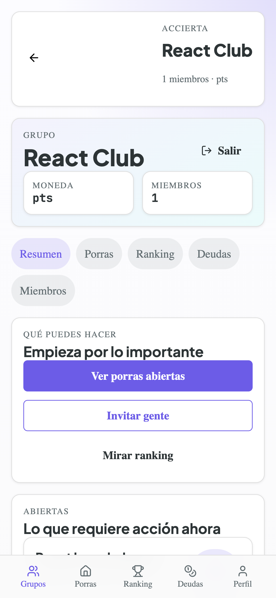
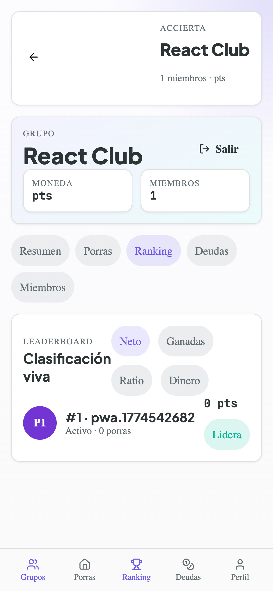
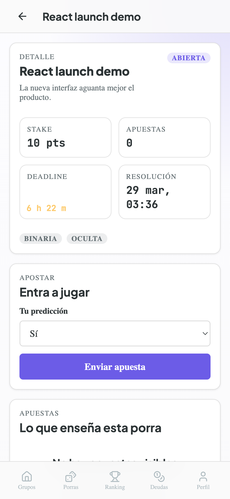
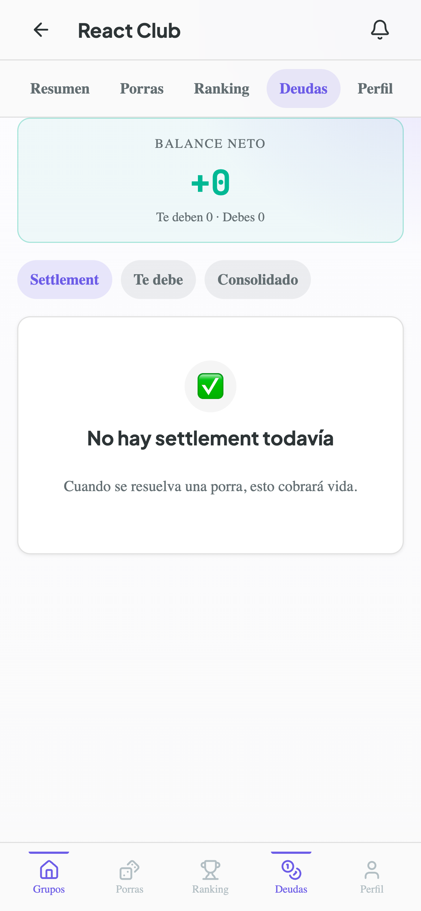

# Accierta

A web app for friend groups to make predictions on anything ("porras"), bet fictional points and compete on a leaderboard over time. Real money, if any, is settled by the group outside the app.

It exists because friendly bets usually live in a WhatsApp chat and get lost: there is no history, no ranking, and the result is never clearly agreed. Accierta keeps the history, runs a consensus step to resolve each prediction, and tracks who ends up owing what.

This is a side project. It is a working prototype and an experiment in building with AI agents, not a production service.

## What it does

- Closed groups of friends, joined by invitation link.
- Any member can create a prediction. The rest bet before the deadline.
- When the event happens, the group resolves the result through proposals, disputes and voting.
- Points are distributed, the ranking is updated and debts between members are generated.
- Installable as a PWA, with push notifications.

## Stack

| Layer | Technology |
|---|---|
| Backend | Java 21, Spring Boot 3, Spring Modulith |
| Persistence | PostgreSQL, hand-made event store |
| Real time | Spring WebSocket |
| Auth | Email and password, written from scratch |
| Email | Resend (registration, password reset, invitations) |
| Frontend | React PWA, TypeScript, Tailwind CSS |
| Tests | JUnit 5, Mockito, Testcontainers, ArchUnit |
| Build and run | Gradle (Kotlin DSL), Docker Compose |

## Architecture

- **Modular monolith.** Five bounded contexts, each a Spring Modulith module: identity, groups, betting, resolution and settlement. They talk to each other only through domain events.
- **Hexagonal architecture.** The domain is pure Java, with no framework annotations. It defines ports, and the infrastructure and API layers implement them. ArchUnit tests enforce the dependency rules.
- **Event sourcing, no framework.** Aggregates emit events and are rebuilt by replaying them. The event store is a PostgreSQL table. Projections for reading are built from the events.

The reasoning behind each choice is in [`docs/adr`](docs/adr), and the overview is in [`docs/architecture.md`](docs/architecture.md).

## How it is developed

The project follows spec-driven development. Every feature starts as a written spec in [`docs/specs`](docs/specs), with its rules, edge cases and acceptance criteria. Tests are derived from the spec, then the code. A feature is not considered done until it has also been checked by hand in a real browser.

Most of the code was written with AI coding agents. Their instructions live in the repository: [`CLAUDE.md`](CLAUDE.md) and [`AGENTS.md`](AGENTS.md) describe the conventions, and [`.claude`](.claude) and [`.codex`](.codex) hold the agent definitions and skills (spec writing, spec verification, test derivation, manual verification and others). The architecture decisions are recorded as ADRs so that the next person, or the next agent, can see why something was done and change it.

## Running it locally

Everything runs in Docker, so there is nothing to install besides Docker.

```bash
docker compose up -d       # backend, frontend and PostgreSQL
docker compose down -v     # stop and wipe the database
```

By default the frontend is on http://localhost:3000, the API on http://localhost:8080 and PostgreSQL on port 5432. The ports can be changed with `FRONTEND_PORT`, `APP_PORT` and `POSTGRES_PORT`.

Web push notifications need a VAPID key pair, set with `ACCIERTA_PUSH_PUBLIC_KEY` and `ACCIERTA_PUSH_PRIVATE_KEY`. Transactional email needs `ACCIERTA_EMAIL_API_KEY`. The full list of settings is in [`docs/deployment.md`](docs/deployment.md).

## Documentation

- [`PRD.md`](PRD.md): the original idea (in Spanish).
- [`docs/specs`](docs/specs): feature specifications, the source of truth.
- [`docs/adr`](docs/adr): architecture decision records.
- [`docs/architecture.md`](docs/architecture.md): system overview.
- [`docs/deployment.md`](docs/deployment.md): deployment topology.
- [`docs/design-system.md`](docs/design-system.md): UI guide.

## Screenshots

Captured during development, with test data.

| | |
|---|---|
|  |  |
|  |  |
